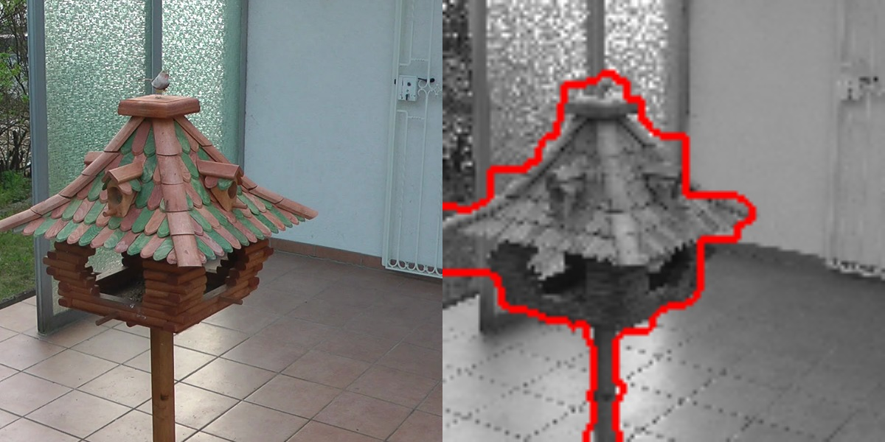
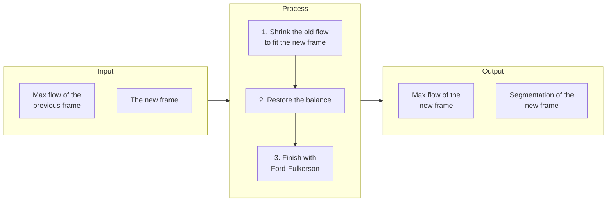
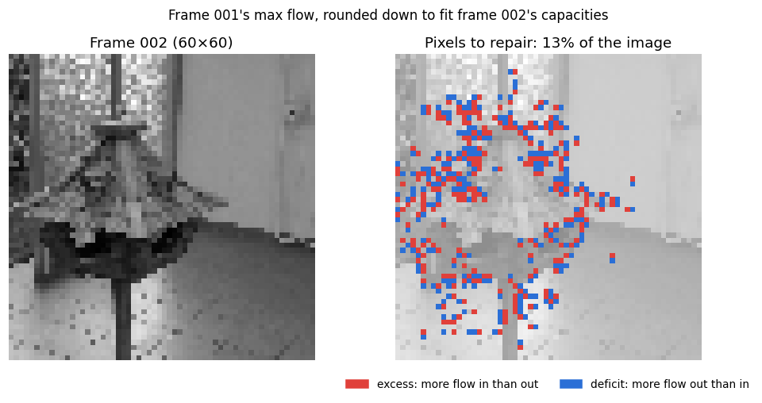
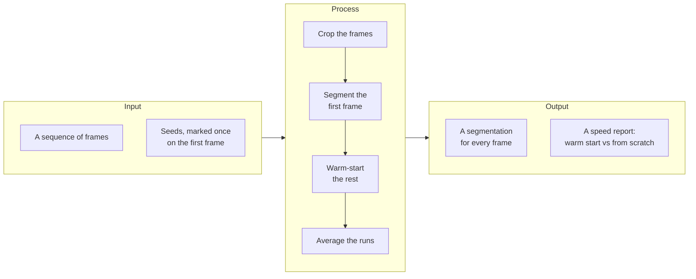

<div align="center">

# ✂️ Warm-Start Graph Cut for Image Segmentation

**Fast video segmentation that reuses the previous frame's max-flow solution instead of solving every frame from scratch.**


[](https://arxiv.org/abs/2303.00837)



*Left: the original frame (cropped to the working area). Right: the result, where the red line is the min cut separating the birdhouse from the background.*

</div>

This repo is a restructured, beginner-friendly version of the implementation for the paper [**"Predictive Flows for Faster Ford-Fulkerson"**](https://arxiv.org/abs/2303.00837) by Yuyan Wang, Siddhartha Banerjee, and David P. Williamson.

**Headline result:** on the birdhouse sequence, the warm start is **31% to 42% faster** than solving every frame from scratch at 60×60 and 120×120 (it is slightly slower at 30×30). Measured on a single machine, see [Sample Results](#sample-results).

**Original Repository**: [wang-yuyan/warmstart-graphcut-algorithms-pulic](https://github.com/wang-yuyan/warmstart-graphcut-algorithms-pulic)

- [Background](#background)
- [What's This About?](#whats-this-about)
- [Key Terms](#key-terms)
- [How the Warm-Start Works](#how-the-warm-start-works)
- [Prerequisites](#prerequisites)
- [Dataset](#dataset)
- [Quick Start](#quick-start)
- [Running It Step by Step](#running-it-step-by-step)
  - [Step 1: Crop the Images](#step-1-crop-the-images)
  - [Step 2: Segment the First Frame](#step-2-segment-the-first-frame)
  - [Step 3: Run the Warm-Start on the Whole Sequence](#step-3-run-the-warm-start-on-the-whole-sequence)
  - [Step 4: Generate the Performance Report](#step-4-generate-the-performance-report)
- [Example Images](#example-images)
- [Sample Results](#sample-results)
- [Project Structure](#project-structure)
- [Changes From the Original Repository](#changes-from-the-original-repository)
- [Credits and Acknowledgments](#credits-and-acknowledgments)

---

## Background

During grad school, I took a course on **advanced algorithms** where we explored **learning-augmented algorithms** (also known as **algorithms with predictions**). As part of the course, each of us had to choose a research paper, study it in depth, and present it. I chose [**"Predictive Flows for Faster Ford-Fulkerson"**](https://arxiv.org/abs/2303.00837), and after spending some time understanding the ideas and running the authors' code, I decided to clean up the structure and documentation of the project. My hope is that it makes the work easier to follow, so that others can understand and appreciate how cool and elegant the design of this algorithm is.

### Hope you find it as interesting as I did!

---

## What's This About?

Image segmentation is one of the classic problems in computer vision: given an image, separate the object from the background. One elegant way to do it is to turn the image into a graph, with one node per pixel, and then look for the cheapest way to cut that graph in two. That cut traces the boundary between object and background, and finding it is a **max-flow / min-cut** problem, the kind an algorithm like **Ford-Fulkerson** is built to solve.

Now picture a video instead of a single photo. From one frame to the next, almost nothing changes. The camera drifts a little and the light shifts slightly, but the scene stays essentially the same:

<table>
  <tr>
    <td align="center"><br><sub>Frame 001</sub></td>
    <td align="center"><br><sub>Frame 005</sub></td>
    <td align="center"><br><sub>Frame 010</sub></td>
  </tr>
</table>

*Three frames from the birdhouse sequence. Look closely and the viewpoint has shifted, but each frame is nearly a copy of the one before it.*

A classical algorithm throws all of that away. It solves every frame from scratch, carefully re-deriving an answer that is almost identical to the one it found a moment earlier. The warm-start approach refuses to waste that effort. It takes the solution of the previous frame, treats it as a **prediction** for the current one, and only fixes the parts that actually moved. That is the whole point of a **learning-augmented algorithm**: a good prediction buys you speed, and here it costs you nothing in accuracy, because the result is always checked against the answer you would have gotten the slow way.

---

## Key Terms

If you haven't worked with graph cuts before, these are the terms used throughout the rest of this README.

| Term | Meaning |
|---|---|
| **Graph** | Every pixel becomes a node, and neighboring pixels are connected by edges. Two special nodes are added: the **source**, which represents the object, and the **sink**, which represents the background. |
| **Capacity** | The amount of flow an edge can carry. Edges between pixels of similar brightness get a high capacity, while edges between very different pixels get a low one, so the cut tends to follow the edges of the object. |
| **Max flow** | The largest total amount of flow that can be sent from the source to the sink without exceeding the capacity of any edge. |
| **Min cut** | The cheapest set of edges whose removal separates the source from the sink. It is obtained from the max flow, and it traces the boundary between object and background. |
| **Seeds** | Pixels you mark by hand as object or background, so the algorithm knows what you want to separate. |
| **Cold start** | Computing the max flow from scratch, starting from zero flow. |
| **Warm start** | Computing the max flow starting from a prediction, which in our case is the max flow of the previous frame. |

---

## How the Warm-Start Works

For every new frame, `warmstart.py` takes the previous frame's max flow and reshapes it into the one the new frame needs. It happens in three steps:



Each solved frame then feeds into the next, so the whole sequence is handled as one continuous chain. Here is what each step actually does:

1. **Shrink the old flow to fit the new frame** (`RoundDown`). Because the new frame looks slightly different, some of its edge capacities are lower than before. Wherever the old flow no longer fits, it is cut down to the new capacity. The result respects every capacity, but it leaves some pixels **out of balance**: they now have more flow coming in than going out (an **excess**), or more going out than coming in (a **deficit**).
2. **Restore the balance** (`FeasProj`). The code then looks for short paths from pixels with an excess to pixels with a deficit, and moves flow along them until every pixel is balanced again. The paper calls this step the *feasibility projection*.
3. **Finish with Ford-Fulkerson** (`augmentingPath`). Starting from this balanced flow, Ford-Fulkerson keeps finding paths with spare capacity and pushing more flow through them until none are left. At that point the flow is maximal, and the min cut gives us the segmentation.

To see why this pays off, here is what step 1 leaves behind when the flow of frame 001 is reused for frame 002:



Only about 13% of the pixels end up out of balance, and they are concentrated around the edges of the birdhouse, which is exactly where the image changed between the two frames. The flat background needs no repair at all, so most of the old solution is reused as it is.

This is the key insight of the paper: the running time depends on how far the prediction is from the correct answer, not on the sheer size of the graph. Consecutive frames give close predictions, so there is only ever a thin strip of work left to do, no matter how large the image gets.

---

## Prerequisites

You'll need **Python 3.8 to 3.11**, since the pinned `numpy==1.24.4` doesn't install on Python 3.12 or newer. Step 2 also opens an interactive window where you mark the seeds with your mouse, so the code has to run locally on your own machine rather than on a remote server.

Once you have that, install the dependencies:

```bash
pip install -r requirements.txt
```

---

## Dataset

The images come from the [image sequence dataset](https://lmb.informatik.uni-freiburg.de/resources/datasets/sequences.en.html) published by the Pattern Recognition and Image Processing group at the University of Freiburg (scroll down the page to see the individual groups).

The paper uses four groups: BIRDHOUSE, HEAD, SHOE, and DOG. To keep things simple, this repo includes only **BIRDHOUSE**, **HEAD**, and **SHOE**, with 10 or 11 consecutive frames each. DOG is left out because it is a large video (**4.8 GB**), and the other three groups are more than enough to understand how the algorithm works.

The images are organized like this:

```
sequential_datasets/
├── birdhouse/
├── head/
└── shoe/
```

Frames are processed in **alphabetical order of their file names**, so make sure the names follow the order of the sequence (for example `birdhouse_001.jpg`, `birdhouse_002.jpg`, and so on).

If you'd like to use more frames, download the dataset, extract the frames, and place them in the matching folder. You can also add a group of your own by creating a new folder inside `sequential_datasets`. In that case, add the group name to `ALL_GROUPS` in `imagesegmentation.py`, and to `all_groups` and `frames` (which sets the crop area) in `image_cropping.py`.

---

## Quick Start

The whole project is four commands, each one feeding into the next. You bring the frames and a single set of seeds, and you get back a segmentation of every frame along with a report on how much time the warm start saved:



Here are those commands, ready to run right after cloning the repo. To try a different group, just replace `birdhouse` with `head` or `shoe`.

```bash
python image_cropping.py -g birdhouse                                              # 1. crop the images
python imagesegmentation.py -i birdhouse_001_cropped.jpg -g birdhouse -s 30 -l no  # 2. segment the first frame
python warmstart.py -g birdhouse -s 30                                             # 3. warm-start the whole sequence
python average.py -g birdhouse                                                     # 4. generate the report
```

Each step is explained in more detail below.

---

## Running It Step by Step

### Step 1: Crop the Images

```bash
python image_cropping.py -g birdhouse
```

This crops every image in `sequential_datasets/birdhouse`, converts it to grayscale, and saves the results in a new folder called `sequential_datasets/birdhouse_cropped`.

---

### Step 2: Segment the First Frame

```bash
python imagesegmentation.py -i birdhouse_001_cropped.jpg -g birdhouse -s 30 -l no
```

This step segments the first frame of the sequence, and it is the only part where you need to do anything by hand. Here is what the options mean:

- `-i birdhouse_001_cropped.jpg` is the image to segment.
- `-s 30` resizes the image to 30×30 pixels before building the graph. You can also use `60` or `120`; larger sizes give sharper results but take much longer to run.
- `-l no` tells the script not to load seeds from a file, because you are about to mark them yourself.

When you run the command, a window opens with the image. First, click or drag to place **red** dots on the **object**, then press **ESC**. The same window stays open, so next place **green** dots on the **background** and press **ESC** again. The script then runs the graph cut using your marks.

#### Why Do We Mark Points?

These dots are the **seeds**. The red ones tell the algorithm what belongs to the object, and the green ones tell it what belongs to the background. Without them, the graph cut would have no way of knowing what you want to separate. The good news is that you only have to do this once: the seeds you place here are saved and reused for every other frame in the sequence.

For `-g birdhouse -s 30`, this step creates:

- `sequential_datasets/birdhouse_cuts/30/birdhouse_seeds.csv`, the seeds you placed
- `sequential_datasets/birdhouse_seeded/30/`, the image with your seeds drawn on it
- `sequential_datasets/birdhouse_cuts/30/birdhouse_001_cropped_cuts.jpg`, the segmentation result

---

### Step 3: Run the Warm-Start on the Whole Sequence

```bash
python warmstart.py -g birdhouse -s 30
```

> **❗ Important:** Use the same `-s` value as in Step 2. If you used `-s 30` there, use `-s 30` here too.

This is where the warm start happens. The script loads the seeds you saved in Step 2 and goes through the sequence in order. The first frame is solved from scratch, the second is warm-started from the max flow of the first, the third from the second, and so on until the last frame. No more clicking is needed.

So that the two approaches can be compared, every frame is also solved from scratch, and both running times are recorded. To smooth out timing noise, the whole sequence is run **10 times** (you can change this with `num_trials` in `warmstart.py`).

When it finishes, you'll find:

- `sequential_datasets/birdhouse_cuts/30/`, the segmentation of every frame (both approaches produce the same result)
- `sequential_datasets/birdhouse_results/30_time_<run>.txt`, how long each approach took on each frame
- `sequential_datasets/birdhouse_results/30_path_<run>.txt`, how many paths each approach needed and how long they were

The first frame has no previous frame to start from, so it doesn't appear in the results files.

---

### Step 4: Generate the Performance Report

```bash
python average.py -g birdhouse
```

This averages the results of all runs and writes two summary files to the `sequential_datasets` folder. By default it covers every image size it finds results for; add `-s 30` (or `60` or `120`) to report on just one.

`all_time_averages.txt` contains the average time in seconds, with these columns:

| Column | Meaning |
|---|---|
| `ff` | Time to solve from scratch (cold start) |
| `warm_start` | Total time of the warm start, including restoring the balance |
| `feas_proj` | Time spent restoring the balance alone |
| `ratio(%)` | `1 - warm_start / ff`, written as a fraction. For example, `0.25` means the warm start was 25% faster, and a negative value means it was slower. |

`all_path_averages.txt` contains the average number of paths and their lengths for each approach, written as (mean, standard deviation).

**A note on the numbers:** the code is written in plain Python, so on small images like 30×30 the fixed setup cost (such as copying the graph) can outweigh what the warm start saves, and the warm start may come out slightly slower. The benefit becomes clear on larger images (`-s 60` and `-s 120`), as the [sample results](#sample-results) below show.

---

## Example Images

All of these come from the `birdhouse(sample_output)` folder and were generated with `-s 120`. At `-s 30` you get the same segmentation, just at a lower resolution.

**From a single frame to its segmentation:**

<table>
  <tr>
    <td align="center"><br><sub>Original frame</sub></td>
    <td align="center"><br><sub>Step 1: cropped and grayscaled</sub></td>
    <td align="center"><br><sub>Step 2: seeds<br>(red = object, green = background)</sub></td>
    <td align="center"><br><sub>Step 2: result<br>(red line = the min cut)</sub></td>
  </tr>
</table>

**Across the sequence:** the seeds were placed only once, on frame 001, yet the boundary keeps following the birdhouse as the camera moves around it.

<table>
  <tr>
    <td align="center"><br><sub>Frame 001</sub></td>
    <td align="center"><br><sub>Frame 005</sub></td>
    <td align="center"><br><sub>Frame 010</sub></td>
  </tr>
</table>

---

## Sample Results

These results are for the birdhouse group, averaged over 10 runs of the full sequence on a single machine. The raw files are in `birdhouse(sample_output)/birdhouse_results`.

| Image size | From scratch | Warm start | Difference |
|---|---|---|---|
| 30×30 | 0.16 s | 0.17 s | 7% slower |
| 60×60 | 2.51 s | 1.46 s | **42% faster** |
| 120×120 | 20.7 s | 14.3 s | **31% faster** |

On the smallest images the warm start is slightly slower, because the setup cost outweighs the savings. On the larger images it comes out clearly ahead, running 31% to 42% faster.

One detail is worth a second look: the biggest win is at 60×60, not at the largest size. That actually follows the paper's own logic. The larger the image, the more pixels a small camera move disturbs, so the prediction drifts a little further from the correct answer and leaves a little more to repair. You can watch it happen in the numbers, as the share of out-of-balance pixels climbs from 24% at 30×30 to 40% at 120×120. The warm start still wins comfortably at 120×120; it simply has more cleanup to do than it did at 60×60.

The path statistics show where the savings come from. At 120×120:

| | From scratch | Warm start |
|---|---|---|
| Number of paths | 1,955 | 1,919 to restore the balance, plus 43 to finish |
| Average path length | 28 edges | 14 edges to restore the balance |

Both approaches need roughly the same number of paths, but the paths of the warm start are about half as long. That is because each one only repairs a small, local imbalance near where the image changed, instead of carrying flow all the way across the image.

Your exact numbers will differ on another machine, but the overall pattern should be the same.

---

## Project Structure

```
.
├── image_cropping.py           # crop and grayscale the frames
├── imagesegmentation.py        # segment one frame from scratch (the cold start)
├── warmstart.py                # the warm-start algorithm and the experiment
├── augmentingPath.py           # Ford-Fulkerson, with or without a starting flow
├── average.py                  # average the results into a report
├── pushRelabel.py              # another max-flow algorithm, left over and unused
├── requirements.txt
├── sequential_datasets/        # the input frames, one folder per group
├── birdhouse(sample_output)/   # example outputs for the birdhouse group
└── docs/                       # images used in this README
```

---

## Changes From the Original Repository

Aside from restructuring the project and rewriting the documentation, there is one change to the code itself. The original read the frames in whatever order `os.listdir` returned them, which is arbitrary, so a frame was often warm-started from one that wasn't next to it in the sequence. Sorting the frames by file name fixes this, and in a side-by-side test at 60×60 it raised the warm-start speedup from about 24% to 42%. The algorithm itself is unchanged.

---

## Credits and Acknowledgments

This work is based on:
- **Paper**: [Predictive Flows for Faster Ford-Fulkerson](https://arxiv.org/abs/2303.00837) by Yuyan Wang, Siddhartha Banerjee, and David P. Williamson
- **Original Repository**: [wang-yuyan/warmstart-graphcut-algorithms-pulic](https://github.com/wang-yuyan/warmstart-graphcut-algorithms-pulic)

More detailed descriptions can be found in the comments inside the code files.

---

#### *That's it! The algorithm is pretty clever: by reusing information from previous frames, it only has to fix what changed instead of starting over every time. Pretty cool, right?*
